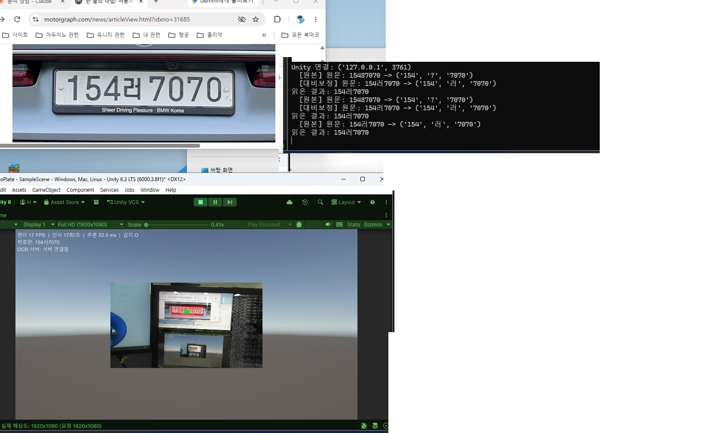
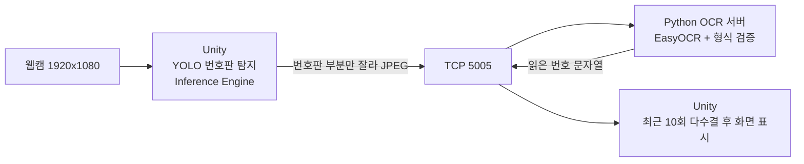

# Unity 번호판 인식 파이프라인 (Unity 추론 + Python OCR)

> Unity에서 YOLO 모델로 번호판을 찾고, 잘라낸 이미지를 TCP로 Python OCR 서버에 보내 번호를 읽어 화면에 표시합니다.



왼쪽 위는 정답 번호판 사진, 왼쪽 아래는 Unity 화면(감지 상자와 "번호판: 154러7070" 표시), 오른쪽은 OCR 서버 로그입니다.

## 전체 흐름



## 구성

| 위치 | 역할 |
|---|---|
| `Assets/Scripts/PersonDetector.cs` | 웹캠 프레임을 YOLO(ONNX)로 추론해 번호판 위치를 찾고 상자·포인터를 그림 (※ 이름은 사람 포인터 프로젝트에서 이어받은 것이며 번호판 모델을 로드함) |
| `Assets/Scripts/PlateOcrClient.cs` | 번호판 부분을 잘라 TCP로 전송, 결과를 받아 다수결 후 표시. 네트워크는 별도 스레드 |
| `Assets/Scripts/WebCamDisplay.cs` | 웹캠 화면 표시 (1920x1080 요청) |
| `python/ocr_server.py` | EasyOCR로 번호판 글자를 읽고 형식을 검증해 돌려줌 |

## 통신 규칙 (TCP, 127.0.0.1:5005)

- 요청: `[4바이트 길이(빅엔디안)] + [JPEG 바이트]`
- 응답: `[4바이트 길이(빅엔디안)] + [UTF-8 문자열]` (읽지 못하면 빈 문자열)
- Unity는 감지된 동안 0.5초 간격으로 한 장씩 보내고, 이전 요청의 응답이 오기 전에는 다음 이미지를 보내지 않습니다.

## OCR 후처리에서 신경 쓴 점

- 번호판 형식(`숫자 2~3 + 한글 1 + 숫자 4`)에 맞는 결과만 사용합니다.
- EasyOCR가 글자 덩어리를 엉뚱한 순서로 돌려주는 경우가 있어(예: `3108152가`), 왼쪽 위치(x) 순서로 직접 정렬해서 이어 붙입니다.
- 이미지가 커지면 번호판 주변의 작은 글씨까지 읽어서 긴 엉터리 문자열이 나오므로, 가장 큰 글자 높이의 60% 미만인 덩어리는 버립니다.
- 전처리 방식(원본 / 대비 보정 / 선명화 / 6배 확대)을 차례로 시도하고, 한글까지 읽히면 거기서 멈춥니다. 끝까지 한글이 안 읽히면 `?`로 표시하고 지어내지 않습니다.
- Unity 쪽은 최근 10번의 결과에서 앞뒤 숫자를 먼저 다수결로 정한 뒤, 같은 숫자를 가진 결과들 중 `?`가 아닌 한글을 다수결로 고릅니다.

## 실행 방법

### 1. 모델 준비

번호판 탐지 모델은 [python_numberPlate](https://github.com/jay-7314/python_numberPlate)에서 학습한 YOLOv8n입니다 (테스트셋 mAP50 0.871). 모델 파일은 이 저장소에 포함하지 않습니다. 해당 저장소의 `saved_models/license_plate_best.pt`를 받아 ONNX로 변환합니다.

```bash
pip install ultralytics
yolo export model=license_plate_best.pt format=onnx imgsz=640 opset=15
```

변환한 `license_plate_best.onnx`를 `Assets/model/`에 넣고, 씬의 `Manager` 오브젝트에 붙은 `Person Detector`의 **Model Asset**에 지정합니다.

### 2. OCR 서버 실행

```bash
pip install easyocr opencv-python-headless
python python/ocr_server.py
```

GPU를 쓰려면 CUDA용 PyTorch가 필요합니다 (`GPU 사용: True`가 출력되면 적용된 것입니다).

### 3. Unity 실행

Unity 6000.3.8f1에서 이 폴더를 프로젝트로 열고(패키지: `com.unity.ai.inference`) 재생합니다. 번호판 사진을 웹캠 앞에 두면 "번호판:" 줄에 결과가 표시됩니다.

## 개발 환경

Unity 6000.3.8f1 · Unity Inference Engine · C# · Python 3.11 · EasyOCR · OpenCV · RTX 3060 Ti

## 확인한 것

- Unity에서 직접 학습한 번호판 모델이 실시간으로 동작합니다.
- 1920x1080 웹캠에서 번호판 부분을 잘라 TCP로 전송하고, OCR 결과가 화면에 표시되는 흐름이 끝까지 동작합니다.
- 시연 화면의 번호판 `154러7070`은 한글까지 정확히 읽혔습니다.
- 웹캠 앞에 띄운 번호판 사진으로 확인했으며, 인식률은 측정하지 않았습니다.

## 출처와 라이선스

- 번호판 탐지 모델 학습 데이터: Roboflow Universe "Korea Car License Plate" (CC BY 4.0)
- Ultralytics YOLO는 AGPL-3.0입니다. 이 저장소에는 모델 가중치를 포함하지 않습니다.
- OCR: [EasyOCR](https://github.com/JaidedAI/EasyOCR) (Apache-2.0)
